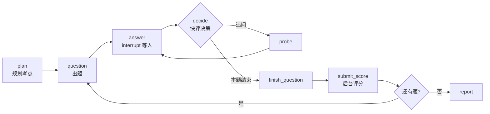

# Mock Interview Agent

用 **LangGraph** 搭建的 AI 模拟面试官。给定一个主题（可选简历、目标 JD），它会自己规划考点、
逐题提问、根据你的回答决定继续追问还是换题，最后对每道题给出**带证据引用的四维评分**和一份 Markdown 报告。

```
Python 3.11+ · LangGraph / LangChain · FastAPI · SQLite
出题 / 追问 / 快评：DeepSeek    单题评分：Qwen
```

命令行和 Web 两个入口共用同一张状态图与同一套约束，一份数据可以两边接着用。

## 它能做什么

- **自主出题**：先规划本场考点（数量与难度分布），再逐题生成；不会重复同一个坑。
- **动态追问**：最新回答交给「快评」判断——是在作答、在澄清题意，还是明确放弃；据此决定追问、给一次补充机会，还是收尾换题。每题最多 3 次追问 + 1 次题意澄清。
- **证据化评分**：评分时先列证据（引用具体回合原文），再给四维分数。未问到的维度记 `null`（「未评估」），**不折算、不填零**；有未评估维度就不给总分。
- **随时中断，随时恢复**：Ctrl-C、关浏览器、重启服务，都能从断点接着说。恢复后不会重复调用已经成功的模型请求。
- **可诊断**：每次真实模型调用落一行（环节、耗时、token、成败、重试次数），页面上直接看得到一场面试花在了哪里。
- **可分享**：内置访问令牌体系——长期令牌自用不限配额，临时令牌按「首用起 N 小时 + token 配额」发给朋友。

## 技术看点

想快速判断代码质量的话，建议看这几处：

1. **用 LangGraph 原生中断做「等人回答」**：`answer` 节点调 `interrupt()` 结束本轮图执行，拿到回答后用 `Command(resume=...)` 和同一个 `thread_id` 续跑。恢复路由交给框架，不手写状态机；等待节点在 `interrupt()` 之前没有副作用，重进是安全的。`durability="sync"` 保证「题目已落盘」之后才到达输入中断。
2. **两个数据库，职责不重叠**：`checkpoints.sqlite` 是**唯一**的进度来源；`operations.sqlite` 只放结果收据、失败用量、用户归属和阶段指标。任何「下一节点是什么」的判断都不许查第二个库——这是让恢复语义可证明的前提。
3. **语义判断与流程控制分离**：模型只输出「证据够不够、缺什么」，追问次数、补充机会、澄清额度全部由代码里的有限计数控制。取消追问的字数限制，也不要求模型引导候选人说出标准答案。
4. **评分不阻塞面试**：`submit_score` 先冻结一份问答副本丢给后台 Task，结果按题目 ID 落盘、后续节点合并。评分服务挂了面试照样结束，报告标注缺分，之后用 `score` 只补评缺的题。
5. **本地校验兜住模型幻觉**：证据引用必须是真实存在的回合，引用文本必须真的出现在该回合的候选人回答里；只有「没问到」类证据的维度不许给数字分。校验失败给一次纠错机会。
6. **重放可控**：成功模型结果带收据，节点重跑可复用；重复记录不会把「恢复过程」算成一次新的模型调用。

## 架构



State 只由节点返回的更新增量推进：`questions` 整体替换，`evaluations` 按题目 ID 合并，
`usage` 按调用 ID 合并，重复收集不会重复计数。回答的 `None`（未回答）与 `""`（主动交白卷）语义不同。

## 快速开始

只需要 [`uv`](https://docs.astral.sh/uv/)，不需要 Docker 或独立数据库（SQLite 就是本地文件）。

```sh
git clone https://github.com/StarJiao/mockinterview-langgraph.git
cd mockinterview-langgraph
uv sync --locked

# 离线演示：无密钥、无网络，固定题目与评分，先看流程和中断恢复
uv run mockinterview new --demo --questions 1
```

命令行输入区：**Enter 换行，先按 Esc 再按 Enter 提交**（空白答案还要再输 `y` 确认），
`Ctrl-C` / `Ctrl-D` 暂停。非交互环境用 `--answers` 文件。

接真实模型：复制 `.env.example` 填密钥，然后

```sh
uv run mockinterview new --env .env --focus 'Agent 工程' --questions 3
```

```sh
uv run mockinterview sessions              # 列出历史会话
uv run mockinterview resume <会话ID> --env .env
uv run mockinterview report <会话ID>       # 导出 Markdown 报告
uv run mockinterview score  <会话ID> --env .env   # 只补评缺分的题
```

## Web 界面

```sh
uv run mockinterview web --demo --port 8000            # 离线演示
uv run mockinterview web --env .env --port 8000        # 真实模型
```

默认监听 `0.0.0.0`，同一网段用 `http://<局域网 IP>:8000` 打开；只想本机访问就传 `--host 127.0.0.1`。
界面包含：登录（用户名 + 令牌）、新建面试（主题/题量/简历/多份 JD）、三角色信息流、
等待期间的阶段提示、历史会话与报告、底部「阶段耗时与 Token 用量」卡片。

单进程、全局一个 `InterviewApp`：进程内多用户并发各自会话是安全的，但**不要与 CLI 同时操作同一个
`--data-dir`**（每会话有文件锁）。

## 公网部署与访问控制

部署走 GitHub：本地 `git push`，服务器 `git pull` + `scripts/deploy.sh`（同步依赖 → 重启服务）。
systemd 单元与 nginx 反代配置在 [`deploy/`](deploy/) 下，首次部署步骤与运维须知见
[DESIGN.md 的部署一节](docs/DESIGN.md)。

站点凭**访问令牌**进入，用户名只是数据分组标签，不做身份鉴权：

```sh
# 自己的长期令牌（不限配额）
uv run mockinterview pass new --days 365 --base-url http://<站点地址>

# 给朋友的临时令牌：自首次使用起 1 小时 + 300000 token 配额，一次签 5 枚
uv run mockinterview pass new --hours 1 --count 5 --label 朋友 --base-url http://<站点地址>

uv run mockinterview pass list        # 查看用量；未激活的令牌尚未开始计时
uv run mockinterview pass revoke <id> # 立即作废
```

带 `--base-url` 会直接输出可分享的 `?pass=TOKEN` 链接。校验只比对 `sha256(token)`，
库里另存一份明文供事后补发（`pass list` 可查）；配额按真实 `stage_metrics` 汇总（含后台评分），
耗尽后只能查看历史与报告，换新令牌可继续未完成的面试。HTTPS 启用时给 `web` 加 `--secure-cookie`。

## 项目结构

```
src/mockinterview/
  graph.py       图的节点与边，没有手写恢复路由
  nodes.py       节点只返回 State 更新，不改共享 Session
  state.py       State、题量/预算分支、追问与澄清的有限次数策略
  runtime.py     checkpointer、启动/恢复、每会话单写者锁
  models.py      LangChain ChatModel 装配
  prompts.py     出题 / 快评 / 追问 / 评分提示词
  schemas.py     Pydantic 与证据引用校验
  scoring.py     后台评分任务与结果落盘
  persistence.py checkpoints / operations 两套存储
  telemetry.py   阶段名映射、落库记录、进程内实时进度
  report.py      Markdown 报告
  cli.py         命令行入口
  web.py         FastAPI 入口（中间件做令牌校验）
  web_static/    前端（原生 JS，无构建步骤）
tests/           103 个测试，真实 SQLite + 固定模型替身
deploy/          systemd 单元、nginx 配置
```

## 测试

```sh
uv run pytest -q                 # 103 passed
uv run ruff check src tests
```

测试用真实 SQLite checkpoint 加固定模型替身，覆盖重启续答、追问上限、空答案、模型失败重试、
checkpoint 写入失败、后台评分重叠与补交、并发打开保护、中文多行编辑，以及 Web 侧的按用户隔离、
令牌过期/作废/配额耗尽、首用计时、阶段指标落库。**不含**真实模型效果验证与浏览器输入法验证——
提示词与评分的语义质量只能靠真实样例人工审查，这一点写在 [DESIGN.md](docs/DESIGN.md) 里。

## 更多

- [`docs/DESIGN.md`](docs/DESIGN.md)：图与恢复机制、面试与评分策略、令牌与配额模型、提示词版本对比、验证记录。
- [`docs/verification-2026-11-06.md`](docs/verification-2026-11-06.md)、[`docs/prompt-comparison-2026-11-08.md`](docs/prompt-comparison-2026-11-08.md)：真实模型运行记录与提示词 A/B 结果。
- [`inputs/`](inputs/)：JD / 简历 / 预定问题 / 离线答案样例。

## 已知边界

- 不承诺 exactly-once：服务端已返回但本地记录未落盘时崩溃，仍可能重复调用一次。
- 不自动迁移被改过的旧图 checkpoint；改图后旧会话按原样只读或结束。
- token 预算是软上限，缺 usage 的失败请求无法精确计费，报告不能替代账单。
- 报告是单题评价的汇总，没有整场模型总评。
